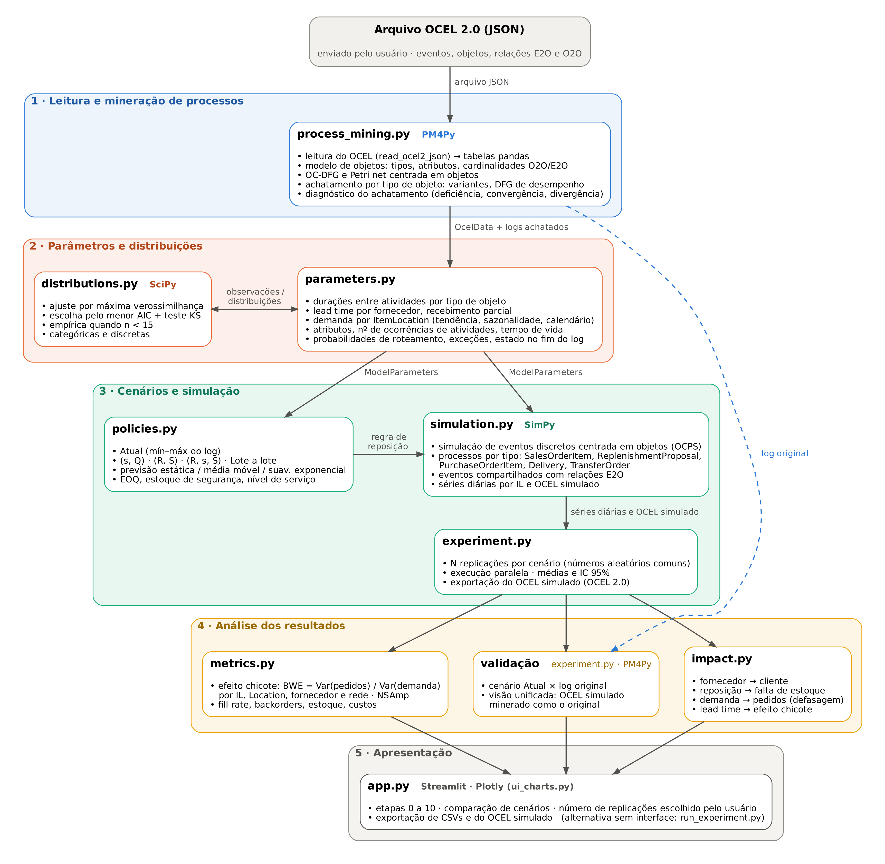

# Simulação centrada em objetos da cadeia de suprimentos — efeito chicote

Simulação de eventos discretos (SimPy) construída a partir de um log **OCEL 2.0** (PM4Py),
seguindo a lógica do **OCPS — Object-Centric Process Simulation** (Knopp & van der Aalst;
repositório `beneknopp/OCPS`), para comparar regras de reposição quanto ao **efeito chicote**.

## Como executar

```bash
pip install -r requirements.txt
streamlit run app.py                 # interface passo a passo
python run_experiment.py --ocel caminho/do/arquivo_ocel.json --reps 30   # execução em lote
```

O arquivo OCEL **sempre** precisa ser enviado: na interface, pelo campo de upload na barra lateral
(o app só libera as etapas depois do envio); na execução em lote, pelo argumento obrigatório `--ocel`.

## Arquitetura



O diagrama é gerado com Graphviz a partir de `assets/fluxo.dot` (`dot -Tpng -Gdpi=220 assets/fluxo.dot -o assets/fluxo_projeto.png`).

## Etapas (interface)

| Etapa | O que faz | Módulo |
|---|---|---|
| 1 · Dados OCEL | tipos de objetos, atributos, atividades, E2O/O2O e cardinalidades | `ocsim/process_mining.py` |
| 2 · Mineração | OC-DFG e OCPN (PM4Py), variantes e DFG de desempenho por tipo de objeto | `ocsim/process_mining.py` |
| 3 · Distribuições | ajuste (MLE + AIC, teste KS) de durações, quantidades, atributos, nº de ocorrências de atividades por objeto, tempo de vida, demanda por IL, cardinalidades | `ocsim/parameters.py`, `ocsim/distributions.py` |
| 4 · Cenários | regras de reposição e seus parâmetros | `ocsim/policies.py` |
| 5 · Simulação | modelo SimPy centrado em objetos, N replicações (escolhidas pelo usuário) | `ocsim/simulation.py`, `ocsim/experiment.py` |
| 6 · Validação | cenário Atual × log (frequências, variantes, lead time, efeito chicote) | `ocsim/experiment.py` |
| 7 · Visão unificada | OCEL simulado minerado com PM4Py lado a lado com o original (atividades/dia, variantes, DFG de desempenho, OC-DFG, modelo de objetos) | `app.py` |
| 8 · Comparação | efeito chicote (razão de variâncias ou coeficiente de variação) por IL / Location / fornecedor / rede, serviço e custos, IC 95% | `ocsim/metrics.py` |
| 9 · Impacto entre objetos | fornecedor → cliente, reposição → falta de estoque, demanda → pedidos (correlação defasada) e sensibilidade do BWE ao lead time; log original × simulados | `ocsim/impact.py` |
| 10 · Exportar | CSVs e OCEL simulado (mesmo esquema do original) | — |

## Correspondência com o OCPS

1. **Modelo de objetos** — objetos estruturais (Location, Material, Supplier, Planner, ItemLocation) e ligações O2O
   vêm do log; objetos transacionais (SalesOrderItem, ReplenishmentProposal, PurchaseOrderItem, Delivery,
   TransferOrder) são criados na simulação respeitando as cardinalidades mineradas
   (ex.: fornecedor do PO ~ P(fornecedor | IL); Delivery existe com P = 0,95).
2. **Comportamento por tipo de objeto** — um processo SimPy por objeto transacional percorre as variantes
   do seu ciclo de vida; durações entre atividades consecutivas vêm do achatamento PM4Py por tipo de objeto.
3. **Sincronização** — eventos compartilhados (ex.: *Goods Receipt* liga PO, Delivery, IL, Material, Location,
   Supplier) são registrados uma vez com todas as relações E2O.
4. **Avaliação** — o OCEL simulado do cenário Atual é comparado ao original (etapa 6).

## Recomendações de van der Aalst (2023), *Toward More Realistic Simulation Models Using OCPM*

| Recomendação | Onde está |
|---|---|
| Descobrir o modelo de simulação dos dados (controle de fluxo, dados, recursos, tempo) | Etapas 2–3 |
| Dados centrados em objetos (E2O/O2O) em vez de um único caso | modelo de objetos + eventos compartilhados |
| Achatamento causa deficiência, convergência e divergência | etapa 2, aba *Qualidade do achatamento* (convergência = 0% neste log) |
| Chegadas de objetos dependem de outros objetos; limitar o comportamento subespecificado da OCPN | SOI nasce do IL; RP/PO nascem do estado do IL; cardinalidades O2O respeitadas |
| Reproduzir o log original antes de perguntar “e se?” | etapa 6 |
| Visão unificada (minerar o log simulado como o original; as-is × to-be) | etapa 7 |
| Simulação de curto prazo a partir do estado atual | etapa 5, *estado inicial = fim do log* (estoques e 20 POs em aberto) |

## Cenários de reposição

* **Atual (mín–máx do log)** — s = 20, S = 80/90, revisão diária com probabilidade calibrada no log (linha de base / validação).
* **Lote Fixo e Ponto de Pedido (s, Q)** — revisão contínua, Q = EOQ.
* **Revisão Periódica com Intervalo Fixo (R, S)** — *order-up-to*, previsão por média móvel (padrão).
* **Revisão Periódica com Intervalo Fixo e Ponto de Pedido (R, s, S)** — o pedido listava “Revisão Periódica com
  Intervalo Fixo” duas vezes; a segunda foi interpretada como a variante com ponto de pedido.
* **Order-Up-To Proporcional (POUT)** — revisão periódica como a (R, S), mas a cada R dias pede
  F·R + α·(S − IP − F·R): corrige só a fração α da diferença até o nível-alvo (Disney & Towill, 2003).
  α = 1 reproduz a (R, S); α < 1 suaviza os pedidos. Na interface, cada α escolhido vira um cenário
  (padrão: α = 0,5 e 0,3).
* **Lote a Lote** — revisão diária, repõe exatamente a necessidade líquida do período.

**Sensibilidade do lead time** — além do fator que multiplica a média do lead time, há um fator de
**dispersão**: LT' = μ + k·(LT − μ), que mantém a média minerada e multiplica o desvio-padrão por k
(k = 0 → lead time constante; k = 1 → como no log). O estoque de segurança usa o σ_L ajustado.
A etapa 9 permite variar a média ou a dispersão.

**Efeito chicote** — duas métricas, calculadas sempre e nos mesmos níveis (IL, Location, fornecedor, rede),
em baldes semanais (configurável), descartando um período de aquecimento:

* **BWE (razão de variâncias)** = Var(pedidos ao fornecedor) / Var(demanda do cliente) — Chen et al. (2000);
* **BWE_CV (coeficiente de variação)** = CV(pedidos) / CV(demanda), com CV = desvio-padrão / média —
  Fransoo & Wouters (2000). Mede a variabilidade relativa à média de cada série e não é distorcida quando a
  média dos pedidos difere da média da demanda (recebimento parcial ≈ 0,84, transição de política, ajustes).
  Com médias iguais, BWE_CV = √BWE.

Na interface, a métrica exibida nas etapas 6, 8 e 9 é escolhida na barra lateral; a etapa 8 traz também uma
tabela com as duas métricas e a posição de cada política em cada uma. Os CSVs exportados trazem as duas.
Também é calculado o NSAmp (variância do estoque líquido / variância da demanda).

## Observações sobre os dados

* No log, o *Goods Receipt* abate o backorder **sem consumir** o estoque recebido. O cenário Atual pode reproduzir
  essa contabilidade (padrão, para validação); os demais usam a contabilidade física correta.
* Os 35 ajustes `FORCED_EPISODE_RESET` foram tratados como artefatos do gerador e não são reproduzidos.
* O lead time minerado (PO → recebimento ≈ 22 dias, Weibull) é muito maior que `mean_lead_time_days` do cadastro
  do fornecedor (2–7 dias); a simulação usa o valor minerado.
* O recebimento é parcial: recebido/pedido ≈ 0,84 em média (distribuição do log).
